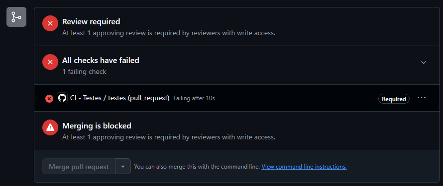

# Catálogo Colaborativo de Jogos

## Integrantes e responsabilidades

| Nome | Matrícula | Usuário GitHub | Funcionalidade (código) | Link da principal PR |
| Artur Maia de Morais | 22610962 | AMaia07 | Favoritos: marcar, listar e remover jogos, validação do apelido e testes | [PR #1](https://github.com/AMaia07/projeto_final_bootcamp_ll/pull/1) |


## Descrição
Aplicação web colaborativa em que o grupo monta um catálogo de jogos, dá notas com comentários e marca favoritos.

- **API consumida:** FreeToGame — https://www.freetogame.com/api/games (sem chave; a lista é carregada uma vez e filtrada no navegador)
- **Banco de dados:** Supabase (PostgreSQL). Tabelas `jogos`, `avaliacoes` e `favoritos` (script em `banco/schema.sql`)
- **Limitação conhecida:** políticas de acesso (RLS) abertas para o papel `anon`; não há login, os usuários são identificados por apelido

## Links
- **Repositório:** https://github.com/AMaia07/projeto_final_bootcamp_ll
- **Docker Hub:** https://hub.docker.com/r/amaia07/catalogo-jogos
- **Aplicação no ar (se houver):** https://amaia07.github.io/projeto_final_bootcamp_ll/

## Como executar localmente
1. Clone o repositório
2. Abra `index.html` no navegador (ou use o Live Server do VS Code)

## Como executar com Docker
```
docker run -d -p 8080:80 amaia07/catalogo-jogos:latest
```
Depois acesse http://localhost:8080. A aplicação não exige variáveis de ambiente.

## Como rodar os testes
```
npm install
npm test
```
Os testes (Jest) cobrem as funções de `utils.js`: `calcularMedia`, `validarNota`, `normalizarBusca`, `filtrarPorTitulo`e `validarApelido`.

## Fluxo de trabalho do time
- A `main` é protegida: só recebe código por Pull Request, com 1 aprovação e o check `testes` verde.
- Cada funcionalidade nasce em uma branch `feature/nome-da-funcionalidade`.

## Evidências

### PR bloqueada pelo CI
Abrimos a PR #N com um teste quebrado de propósito (`calcularMedia([8, 9, 10])` esperando 10 em vez de 9). O check `testes` falhou e o GitHub bloqueou o merge: além do CI vermelho, a PR exigia a aprovação de um colega.



Link da PR: https://github.com/AMaia07/projeto_final_bootcamp_ll/pull/3

### Conflito de merge
Não houve nenhum tipo de conflito no merge.